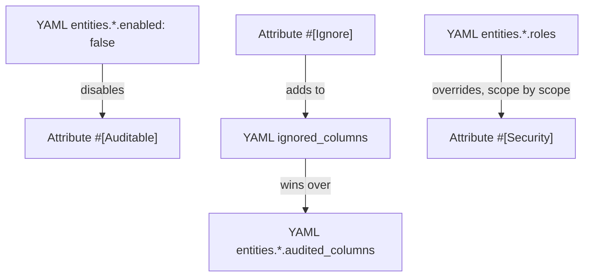

# Entity Attributes

> **Configure auditing with PHP 8 attributes**

PHP attributes provide an alternative to YAML configuration for declaring auditable entities.

> [!NOTE]
> Attributes and YAML configuration are combined: see [Precedence Rules](#-precedence-rules).

## 📋 Available Attributes

| Attribute        | Target   | Description                                      |
|------------------|----------|--------------------------------------------------|
| `#[Auditable]`   | Class    | Marks an entity as auditable                     |
| `#[Ignore]`      | Property, or class with `field:` | Excludes a property from auditing |
| `#[Security]`    | Class    | Defines roles required to view audits            |
| `#[DiffLabel]`   | Property, or class with `field:` | Attaches a human-readable label resolver to a field |
| `#[Mask]`        | Property, or class with `field:` | Records the changes of a property without its values |
| `#[AuditRoot]`   | Class (repeatable) | Attaches the entries to the history of another entity (see [Histories](../customization/histories.md)) |

`#[Auditable]` also takes a retention policy: `#[Auditable(maxAge: 'P1Y', maxEntries: 10_000)]`.

All attributes are in the `DH\Auditor\Attribute` namespace (auditor core).

## 🏷️ #[Auditable]

Marks an entity class for auditing.

### Basic Usage

```php
<?php

namespace App\Entity;

use DH\Auditor\Attribute\Auditable;
use Doctrine\ORM\Mapping as ORM;

#[ORM\Entity]
#[Auditable]
class User
{
    #[ORM\Id]
    #[ORM\GeneratedValue]
    #[ORM\Column]
    private ?int $id = null;

    #[ORM\Column(length: 180)]
    private ?string $email = null;
    
    // ...
}
```

### Disabled by Default

Create an audit table but don't log until enabled at runtime:

```php
#[ORM\Entity]
#[Auditable(enabled: false)]
class User
{
    // Auditing is OFF by default
    // Can be enabled at runtime
}
```

## 🚫 #[Ignore]

Excludes a property from being audited.

```php
<?php

namespace App\Entity;

use DH\Auditor\Attribute\Auditable;
use DH\Auditor\Attribute\Ignore;
use Doctrine\ORM\Mapping as ORM;

#[ORM\Entity]
#[Auditable]
class User
{
    #[ORM\Column]
    private ?string $email = null;

    #[ORM\Column]
    #[Ignore]
    private ?string $password = null;  // Not audited

    #[ORM\Column]
    #[Ignore]
    private ?\DateTimeImmutable $lastLoginAt = null;  // Not audited
}
```

> [!TIP]
> Properties in the global `ignored_columns` configuration don't need `#[Ignore]`.

## 🔒 #[Security]

Restricts access to view audit logs based on user roles.

```php
<?php

namespace App\Entity;

use DH\Auditor\Attribute\Auditable;
use DH\Auditor\Attribute\Security;
use Doctrine\ORM\Mapping as ORM;

#[ORM\Entity]
#[Auditable]
#[Security(view: ['ROLE_ADMIN'])]
class User
{
    // Only users with ROLE_ADMIN can view User audits
}
```

### Multiple Roles (OR Logic)

```php
#[Security(view: ['ROLE_ADMIN', 'ROLE_AUDITOR'])]
class User
{
    // Users with ROLE_ADMIN OR ROLE_AUDITOR can view
}
```

## 📝 Complete Example

```php
<?php

namespace App\Entity;

use DH\Auditor\Attribute\Auditable;
use DH\Auditor\Attribute\Ignore;
use DH\Auditor\Attribute\Security;
use Doctrine\ORM\Mapping as ORM;

#[ORM\Entity]
#[Auditable]
#[Security(view: ['ROLE_ADMIN', 'ROLE_AUDITOR'])]
class User
{
    #[ORM\Id]
    #[ORM\GeneratedValue]
    #[ORM\Column]
    private ?int $id = null;

    #[ORM\Column(length: 180, unique: true)]
    private ?string $email = null;

    #[ORM\Column]
    #[Ignore]
    private ?string $password = null;

    #[ORM\Column(length: 255)]
    private ?string $firstName = null;

    #[ORM\Column(length: 255)]
    private ?string $lastName = null;

    #[ORM\Column]
    #[Ignore]
    private ?\DateTimeImmutable $lastLoginAt = null;

    // Getters and setters...
}
```

## 🔀 Combining with YAML

You can use both attributes and YAML configuration:

```yaml
# config/packages/dh_auditor.yaml
dh_auditor:
    providers:
        doctrine:
            ignored_columns:
                - createdAt
                - updatedAt
            entities:
                App\Entity\User: ~   # Declares entity is auditable
                App\Entity\Post: ~
```

```php
// Entity uses attributes for fine-grained control
#[ORM\Entity]
#[Auditable]
#[Security(view: ['ROLE_ADMIN'])]
class User
{
    #[Ignore]
    private ?string $password = null;
    
    // createdAt and updatedAt are automatically ignored via YAML
}
```

### 📊 Precedence Rules



| Attribute       | Behavior                                    |
|-----------------|---------------------------------------------|
| `#[Auditable]`  | YAML `enabled: false` disables the entity; YAML `enabled: true` does not re-enable `#[Auditable(enabled: false)]` |
| `#[Ignore]`     | Adds to `ignored_columns` (YAML + attribute)|
| `#[Ignore]`     | Wins over `entities.*.audited_columns`: an ignored property is never audited |
| `#[Security]`   | YAML `roles` win, scope by scope: an empty `roles` or a missing `view` key keeps the attribute roles |
| `#[AuditRoot]`  | Adds to `entities.*.roots` (YAML + attribute) |
| `#[Auditable(maxAge, maxEntries)]` | YAML `retention` wins, key by key   |

> [!NOTE]
> `enabled: true` is the default of every entity listed in YAML: it cannot tell an explicit value from the default,
> so it never re-enables an `#[Auditable(enabled: false)]` entity.

## ✅ Entity Not in YAML

An entity with `#[Auditable]` is audited even when it is not listed under `entities`: the attribute alone is enough.
List it in YAML only to add `audited_columns` or `ignored_columns`, set `roles`, disable it (`enabled: false`),
override the retention, or add roots to the `#[AuditRoot]` ones.

---

## 🏷️ #[DiffLabel]

Attaches a **human-readable label resolver** to a scalar property so that audit diffs store `{"value": 1, "label": "Electronics"}` instead of just `1`.

```php
<?php

namespace App\Entity;

use App\Audit\Resolver\CategoryResolver;
use DH\Auditor\Attribute\Auditable;
use DH\Auditor\Attribute\DiffLabel;
use Doctrine\DBAL\Types\Types;
use Doctrine\ORM\Mapping as ORM;

#[ORM\Entity]
#[Auditable]
class Product
{
    #[ORM\Column(type: Types::INTEGER)]
    #[DiffLabel(resolver: CategoryResolver::class)]
    private int $categoryId;
}
```

The `resolver` argument must be the fully-qualified class name of a class implementing `DiffLabelResolverInterface`:

```php
use DH\Auditor\Contract\DiffLabelResolverInterface;

final class CategoryResolver implements DiffLabelResolverInterface
{
    public function __invoke(mixed $value): ?string
    {
        // return a label string, or null to store the plain value
        return match($value) {
            1 => 'Books',
            2 => 'Electronics',
            default => null,
        };
    }
}
```

> [!TIP]
> See the [Diff Label Resolvers guide](../customization/diff-label-resolvers.md) for the full reference, including constraints on resolver behaviour and viewer integration.

---

## 🎭 #[Mask]

Records that a property changed without storing its values: unlike `#[Ignore]`, the change still shows in the
viewer, as `***` or as a hash.

```php
use DH\Auditor\Attribute\Mask;
use DH\Auditor\Masking\MaskStrategy;

#[ORM\Entity]
#[Auditable]
class User
{
    #[ORM\Column]
    #[Mask(strategy: MaskStrategy::KeyedHash)]  // HMAC-SHA256 keyed with "mask_secret"
    private string $email = '';

    #[ORM\Column(nullable: true)]
    #[Mask]                                     // "***"
    private ?string $pin = null;
}
```

`MaskStrategy::KeyedHash` needs the `mask_secret` option of the doctrine provider (see
[Configuration](index.md#mask_secret)): equal values give equal hashes, so the entries of one value can be found
without storing it. A masked field gets no `#[DiffLabel]` label. An identifier or a collection cannot be masked.

> [!WARNING]
> Only the values of the field in the diffs are masked: the label of the entity (its `__toString()` or the
> `entity_label_resolver`), shown in the viewer, is not. Do not build it from a masked field.

See the
[provider documentation](https://damienharper.github.io/auditor-docs/auditor-doctrine-provider/providers/doctrine/attributes#-mask)
for the details.

## 🚀 Next Steps

- ⚙️ [Configuration Reference](index.md) - All YAML options
- 🗄️ [Storage Configuration](storage.md) - Multi-database setup
- 🛡️ [Role Checker](../customization/role-checker.md) - Custom access control
- 🏷️ [Diff Label Resolvers](../customization/diff-label-resolvers.md) - Human-readable labels in diffs
